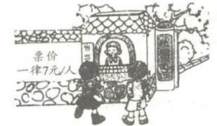

# Mathematics (Grade 3)

**ID**: 9b6f7d43
**难度**: medium_hard
**题型**: fill_in_the_blank

## 题目
买门票。 

（1）23元可以买几张票？ 
□○□=□（张）……□（元）
（2）李婷付50元钱，售票员找回了15元，李婷买了几张票？ 
（□○□）○□=□（张）

## 解答

**答案**: 3, 2, 5

1. Step1:对于问题（1），已知票价为7元/人，总钱数为23元，根据用钱数除以票价，即23÷7，求出商为3，余数为2，商3就是可以买的票数，所以23元可以买3张票
2. Step2:对于问题（2），先计算李婷买票花的钱数，用付的50元减去找回的15元，即50 - 15 = 35元
3. Step3:用李婷买票花的35元除以每张票的7元，即35÷7 = 5，得出李婷买了5张票
4. Step4:将问题（1）可买的票数3、余下的钱数2以及问题（2）李婷买的票数5按顺序组成答案列表['3', '2', '5']

## 知识点

**知识点**:
  - 小学数学;数与代数;应用题;简单应用题;整数简单应用题

---
