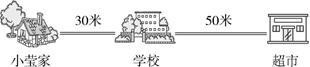

# Mathematics (Grade 3)

**ID**: a4aa5e2c
**难度**: medium_hard
**题型**: fill_in_the_blank

## 题目
从小莹家到学校要走30米，从学校到超市要走50米．

1.小莹每天早上到学校上课，中午放学回家吃饭，一个来回要走多少米？
口答：一个来回要走( )米．
2.小莹从家经过学校到超市要走多少米？
口答：小莹从家经过学校到超市要走(    )米．
3.有一天，小莹早上从家走到学校后，发现文具盒忘带了，赶紧回家去取，然后返回学校．这一天小莹上学一共走了多少米？
口答：这一天小莹上学一共走了(    )米．

## 解答

**答案**: 60, 80, 90

1. Step1:计算小莹早上到学校上课，中午放学回家吃饭一个来回的路程，因为一个来回是从家到学校再从学校到家，距离为从家到学校距离的2倍，即30×2 = 60米
2. Step2:计算小莹从家经过学校到超市的路程，是从家到学校的30米加上从学校到超市的50米，即30 + 50 = 80米
3. Step3:计算小莹早上走到学校后又回家取文具盒再返回学校走的路程，先走了一个从家到学校的30米，回家又走30米，再从家到学校走30米，总共30 + 30 + 30 = 90米

## 知识点

**知识点**:
  - 小学数学;数与代数;应用题;简单应用题;整数简单应用题

---
