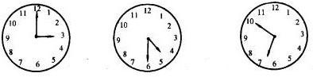

# Mathematics (Grade 3)

**ID**: a95a4413
**难度**: medium_hard
**题型**: fill_in_the_blank

## 题目
读出下面钟面上所指的时刻，再写出来

$\underline{\hspace{5em}}$；$\underline{\hspace{5em}}$；$\underline{\hspace{5em}}$．

## 解答

**答案**: 3:00, 4:30, 6:50

1. Step1:观察第一个钟面，发现分针指向12，时针指向3，根据时钟读数规则，此时刻为3：00
2. Step2:观察第二个钟面，时针在“4”和“5”之间，表明是4时多，分针指向6，因为分针每走一大格代表5分钟，6×5=30，所以此时刻为4：30
3. Step3:观察第三个钟面，时针在“6”和“7”之间，是6时多，分针指向10，10×5=50，所以此时刻为6：50

## 知识点

**知识点**:
  - 时、分、秒及其关系、单位换算与计算．

---
