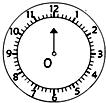

# Mathematics (Grade 3)

**ID**: abfed617
**难度**: medium_hard
**题型**: fill_in_the_blank

## 题目
如图中：指针从“12”绕点O顺时针旋转$\underline{\hspace{5em}}$到“3”．指针从“3”绕点O顺时针旋转180°到$\underline{\hspace{5em}}$．

## 解答

**答案**: 90°, 9

1. Step1:明确钟面一大格对应的角度，因为时针一大格是30°
2. Step2:计算指针从“12”绕点O顺时针旋转到“3”经过的大格数为3大格，3×30° = 90°，所以指针从“12”绕点O顺时针旋转90°到“3”
3. Step3:指针从“3”绕点O顺时针旋转180°，180°÷30° = 6大格，3 + 6 = 9，所以指针从“3”绕点O顺时针旋转180°到“9”

## 知识点

**知识点**:
  - 旋转．

---
