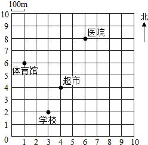

# Mathematics (Grade 3)

**ID**: aea9c364
**难度**: medium_hard
**题型**: fill_in_the_blank

## 题目
如果张强从学校到体育馆往返一次，要走$\underline{\hspace{5em}}$千米．（不能走斜线）

## 解答

**答案**: 1.6

1. Step1:明确图中一个方格代表实际距离100米
2. Step2:计算张强从学校到体育馆经过的方格数，1+2+3+2=8格
3. Step3:计算从学校到体育馆的距离，8×100=800米
4. Step4:计算往返一次的距离，800×2=1600米
5. Step5:将1600米换算为千米，1600米=1.6千米

## 知识点

**知识点**:
  - 简单的行程问题．

---
