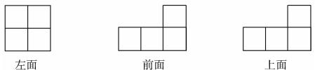

# Mathematics (Grade 3)

**ID**: af4767de
**难度**: medium_hard
**题型**: fill_in_the_blank

## 题目
搭一搭，搭成的立体从左面、前面、上面分别看到的形状如下，需要几个小正方体？

## 解答

**答案**: 6

1. Step1:根据左面、前面看到的形状，判断出这个立体图形有上下两层
2. Step2:结合上面看到的形状，确定这个立体图形最底层有4个小正方体
3. Step3:结合从左面、前面、上面看到的形状，判断出上层有2个小正方体
4. Step4:计算所需小正方体总数，4 + 2 = 6个

## 知识点

**知识点**:
  - 从不同方向观察物体

---
