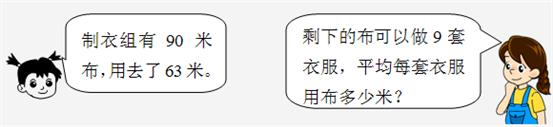

# Mathematics (Grade 3)

**ID**: b05d0fbd
**难度**: medium_hard
**题型**: fill_in_the_blank

## 题目

列式：-------------------------
答：每套衣服用布$\underline{\hspace{5em}}$米．

## 解答

**答案**: 3

1. Step1:根据题目，先计算剩下布的米数，用原有的90米布减去用去的63米布，即90 - 63 = 27米
2. Step2:已知剩下的27米布可以做9套衣服，求平均每套衣服用布多少米，用剩下布的米数除以衣服的套数，即27÷9 = 3米

## 知识点

**知识点**:
  - 整数、小数复合应用题．

---
