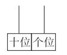

# Mathematics (Grade 3)

**ID**: b0c2bd6d
**难度**: medium_hard
**题型**: fill_in_the_blank

## 题目
数一数，画一画。（shǔ yī shǔ，huà yī huà。）
在计数器上画上2颗珠子，可以组成那些数？

可以组成的数有： $\underline{\hspace{5em}}$ 。

## 解答

**答案**: 20, 2, 11

1. Step1:考虑两颗珠子都在十位的情况，因为十位上有几颗珠子就表示几个十，所以此时组成的数是20
2. Step2:考虑两颗珠子都在个位的情况，由于个位上有几颗珠子就表示几个一，所以此时组成的数是2
3. Step3:考虑一颗珠子在十位，一颗珠子在个位的情况，十位上1颗珠子表示1个十，个位上1颗珠子表示1个一，所以组成的数是11

## 知识点

**知识点**:
  - 

---
