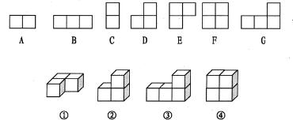

# Mathematics (Grade 3)

**ID**: b32c07e2
**难度**: medium_hard
**题型**: fill_in_the_blank

## 题目
(1)图A是从物体______和______上面看到的．
(2)图C是从物体______、______和______的右面看到的；从正面看物体④是图______．
(3)图G是从物体③的______看到的，图E是从物体①的______面看到的．
(4)图B是从物体______的______面看到的．

## 解答

**答案**: ②, ④, ②, ③, ④, F, 正, 上, ③, 上

1. Step1:观察图A，根据图形特征判断出是从物体②和④上面看到的，得出前两个答案为②，④
2. Step2:观察图C，根据图形特点确定是从物体②、③和④的右面看到的；再观察物体④从正面看的形状，得出是图F，得到中间五个答案为②，③，④，F
3. Step3:观察图G和物体③，得出图G是从物体③的正面看到的；观察图E和物体①，得出图E是从物体①的上面看到的，得到接下来两个答案为正，上
4. Step4:观察图B和物体③，判断出图B是从物体③的上面看到的，得出最后两个答案为③，上

## 知识点

**知识点**:
  - 从不同方向观察物体和几何体．

---
