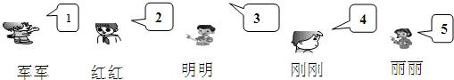

# Mathematics (Grade 3)

**ID**: b47590fd
**难度**: medium_hard
**题型**: fill_in_the_blank

## 题目
报数游戏：

16是$\underline{\hspace{5em}}$报的，27是$\underline{\hspace{5em}}$报的，31是$\underline{\hspace{5em}}$报的．
A．军军   B．红红    C．明明    D．刚刚     E．丽丽．

## 解答

**答案**: A, B, A

1. Step1:把军军、红红、明明、刚刚、丽丽5个人看成一个周期。
2. Step2:计算16÷5=3…1，可知16个数里有3个完整周期，余数为1，所以16是一个周期里第一个人军军报的。
3. Step3:计算27÷5=5…2，可知27个数里有5个完整周期，余数为2，所以27是一个周期里第二个人红红报的。
4. Step4:计算31÷5=6…1，可知31个数里有6个完整周期，余数为1，所以31是一个周期里第一个人军军报的。

## 知识点

**知识点**:
  - 简单周期现象中的规律．

---
