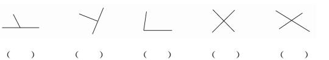

# Mathematics (Grade 3)

**ID**: b62521e3
**难度**: medium_hard
**题型**: fill_in_the_blank

## 题目
下面每组中两条直线是互相垂直的在括号里打“√”，不是互相垂直的打“×”。

## 解答

**答案**: ×, √, ×, √, ×

1. Step1:明确垂直的概念，即两条直线垂直时所组成的角是90°
2. Step2:观察图1，发现两直线组成的角不是90°，判断为不垂直，应打‘×’
3. Step3:观察图2，发现两直线组成的角是90°，判断为垂直，应打‘√’
4. Step4:观察图3，发现两直线组成的角不是90°，判断为不垂直，应打‘×’
5. Step5:观察图4，发现两直线组成的角是90°，判断为垂直，应打‘√’
6. Step6:观察图5，发现两直线组成的角不是90°，判断为不垂直，应打‘×’

## 知识点

**知识点**:
  - 

---
