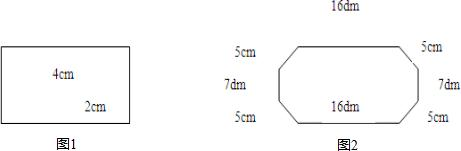

# Mathematics (Grade 3)

**ID**: c0e46f43
**难度**: medium_hard
**题型**: fill_in_the_blank

## 题目
图1这张数学试卷的长约是______厘米，它的宽约是______厘米
它的周长是：(请写出你的计算过程)______
求出图2图形的周长：

## 解答

**答案**: 4, 2, (4+2)*2=12(厘米), 480(厘米)

1. Step1:观察图1，得出图1数学试卷长约4厘米
2. Step2:观察图1，得出图1数学试卷宽约2厘米
3. Step3:根据长方形周长公式(长 + 宽)×2，计算图1周长为(4 + 2)×2 = 12厘米
4. Step4:将图2中16dm换算为160cm，7dm换算为70cm
5. Step5:根据周长计算方法，把图2八条线段长度相加，即160×2 + 70×2 + 5×4 = 320 + 140 + 20 = 480厘米

## 知识点

**知识点**:
  - 长度的测量方法;长方形的周长．

---
