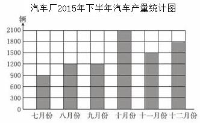

# Mathematics (Grade 3)

**ID**: c364eab5
**难度**: medium_hard
**题型**: fill_in_the_blank

## 题目
看图回答问题。

（1）这张统计图中每一格表示（       ）辆汽车，产量最少是（  ）月份，是（   ）辆；产量最多是（  ）月份，是（   ）辆；最多与最少的月份产量相差（    ）辆汽车，下半年一共生产了（         ）汽车。
（2）平均每个月生产多少辆？

## 解答

**答案**: 300, 七, 900, 十, 2100, 1200, 8700, 1450

1. Step1:观察统计图纵轴，300 - 0 = 300，可知每一格表示300辆汽车
2. Step2:观察统计图，七月份的产量条形最短，其产量是900辆，所以产量最少是七月份，是900辆
3. Step3:观察统计图，十月份的产量条形最长，其产量是2100辆，所以产量最多是十月份，是2100辆
4. Step4:计算最多与最少的月份产量差值，2100 - 900 = 1200辆
5. Step5:计算下半年总产量，900 + 1200 + 1200 + 2100 + 1500 + 1800 = 8700辆
6. Step6:计算平均每月产量，(900 + 1200 + 1200 + 2100 + 1500 + 1800)÷6 = 1450辆

## 知识点

**知识点**:
  - 小学数学;统计和概率;统计;统计图

---
