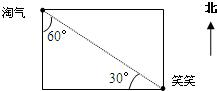

# Mathematics (Grade 3)

**ID**: c7301cd1
**难度**: medium_hard
**题型**: fill_in_the_blank

## 题目
如图，淘气看笑笑在$\underline{\hspace{5em}}$偏$\underline{\hspace{5em}}$的方向上，笑笑看淘气在$\underline{\hspace{5em}}$偏$\underline{\hspace{5em}}$的方向上．

## 解答

**答案**: 南, 东60°, 西, 北30°

1. Step1:明确方向规定为上北、下南，左西、右东
2. Step2:以淘气为观察点，根据图和方向规定，得出淘气看笑笑在南偏东60°的方向上
3. Step3:以笑笑为观察点，根据图和方向规定，得出笑笑看淘气在西偏北30°的方向上
4. Step4:将上述方向结果整理为['南', '东60°', '西', '北30°']

## 知识点

**知识点**:
  - 方向．

---
