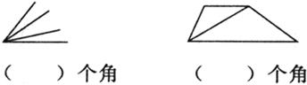

# Mathematics (Grade 3)

**ID**: c7a2db08
**难度**: medium_hard
**题型**: fill_in_the_blank

## 题目
下面图中各有几个角？     

## 解答

**答案**: 6, 8

1. Step1:对于第一个图形，先数出有3个小角，根据角的简便计数方法，角的总数为3+2+1=6个
2. Step2:对于第二个图形，观察得出有4个顶点，从左上方开始，每个顶点处的角分别有1个、3个、1个、3个，所以角的总数为1+3+1+3=8个

## 知识点

**知识点**:
  - 组合图形的计数．

---
