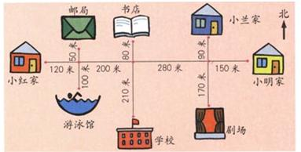

# Mathematics (Grade 3)

**ID**: c9569d26
**难度**: medium_hard
**题型**: fill_in_the_blank

## 题目
填空：

（1）小红从家向东走了320米，又向$\underline{\hspace{5em}}$走了$\underline{\hspace{5em}}$米到学校．
（2）小明从家向$\underline{\hspace{5em}}$走了$\underline{\hspace{5em}}$米，又向$\underline{\hspace{5em}}$走了$\underline{\hspace{5em}}$米到剧场．

## 解答

**答案**: 南, 200, 西, 150, 南, 170

1. Step1:根据地图方向辨别方法“上北下南、左西右东”以及图上信息，先看小红的路线，已知小红从家向东走了320米到达一个位置，观察图可知从该位置到学校是向南走，距离为200米
2. Step2:再看小明的路线，依据地图方向和图上信息，小明从家出发，先向西走了150米到达一个位置，从该位置到剧场是向南走，距离为170米

## 知识点

**知识点**:
  - 路线图．

---
