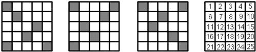

# Mathematics (Grade 3)

**ID**: cc4a9e85
**难度**: medium_hard
**题型**: fill_in_the_blank

## 题目
根据前三幅图的规律，将第四幅图中相应的方格涂黑，涂黑的方格中所填数之和为______．

## 解答

**答案**: 90

1. Step1:观察发现图(1)按顺时针旋转90度得到图(2)
2. Step2:图(2)按顺时针旋转90度得到图(3)
3. Step3:图(3)按顺时针旋转90度得到图(4)
4. Step4:根据规律确定图(4)中涂黑方格对应的值分别为5、25、21、17、14、8
5. Step5:计算涂黑方格对应值的和，即5+25+21+17+14+8=90

## 知识点

**知识点**:
  - 事物的简单搭配规律．

---
