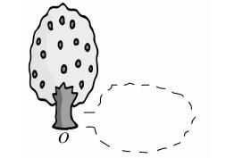

# Mathematics (Grade 3)

**ID**: cd87fd83
**难度**: medium_hard
**题型**: fill_in_the_blank

## 题目
想一想，填一填。

一棵小树被扶起种好，这棵小树绕点O（）方向旋转了（）度。

## 解答

**答案**: 逆时针, 90

1. Step1:明确本题是关于旋转方向和角度的问题
2. Step2:根据与钟面旋转方向的关系判断小树旋转方向，钟面旋转方向为顺时针，相反方向为逆时针，所以小树绕点O的旋转方向为逆时针
3. Step3:观察小树旋转前后的状态，判断出小树绕点O旋转的度数为90度

## 知识点

**知识点**:
  - 旋转

---
