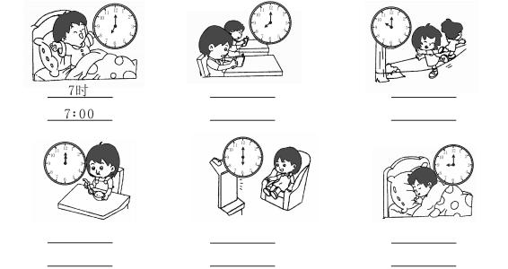

# Mathematics (Grade 3)

**ID**: cf882c99
**难度**: medium_hard
**题型**: fill_in_the_blank

## 题目
用两种不同的方式表示时间。

## 解答

**答案**: 上午8时, 8:00, 上午10时, 10:00, 上午12时, 12:00, 下午6时, 18:00, 晚上9时, 21:00

1. Step1:观察题目，明确需用24时计时法和普通计时法两种方式表示时间
2. Step2:思考24时计时法和普通计时法的转化方法，即普通计时法转化成24时计时法，上午时间不变，下午要加上12小时，同时去掉下午、晚上等名词
3. Step3:根据对钟表的认识结合图片正确读出各个钟表上的时间
4. Step4:将读出的时间用普通计时法表示
5. Step5:将读出的时间用24时计时法表示
6. Step6:整理普通计时法和24时计时法表示的时间，得到答案

## 知识点

**知识点**:
  - 24时计时法;时、分、秒的认识、进率及换算

---
