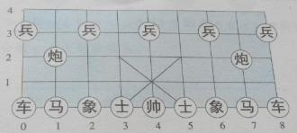

# Mathematics (Grade 3)

**ID**: d5c7585b
**难度**: medium_hard
**题型**: fill_in_the_blank

## 题目

 这是半幅象棋布局图.帅在（4，0）处，炮在（___,___)或（___,___)处。中兵在（___,___)处
 马走日宫格，右边的马可以走到（___,___)或（___,___)处。
 象走田字格，左边的像可以走到（___,___)或（___,___)处。

## 解答

**答案**: (7,2), (1,2), (4,3), (6,2), (8,2), (4,2), (0,2)

1. Step1:观察布局图，确定炮的位置，可得炮在（7，2）或（1，2）处
2. Step2:观察布局图，确定中兵的位置，可知中兵在（4，3）处
3. Step3:根据马走日宫格的规则，观察右边马的位置，得出右边的马可以走到（6，2）或（8，2）处
4. Step4:依据象走田字格的规则，观察左边象的位置，得到左边的象可以走到（4，2）或（0，2）处

## 知识点

**知识点**:
  - --

---
