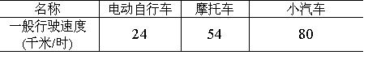

# Mathematics (Grade 3)

**ID**: d8e36f9c
**难度**: medium_hard
**题型**: fill_in_the_blank

## 题目
下表中是三种交通工具的一般行驶速度．

解答下面问题时，如果除不尽保留两位小数．
（1）算出每种车平均每分钟行驶________千米、________千米、________千米(按题目顺序回答)
（2）摩托车的速度是电动车的________倍？
（3）小汽车的速度是摩托车的________倍？

## 解答

**答案**: 0.4, 0.9, 1.33, 2.25, 1.48

1. Step1:因为1小时 = 60分钟，将电动自行车速度24千米/时换算为每分钟行驶的千米数，计算24÷60 = 0.4千米
2. Step2:将摩托车速度54千米/时换算为每分钟行驶的千米数，计算54÷60 = 0.9千米
3. Step3:将小汽车速度80千米/时换算为每分钟行驶的千米数，计算80÷60≈1.33千米
4. Step4:计算摩托车速度是电动车速度的倍数，即54÷24 = 2.25
5. Step5:计算小汽车速度是摩托车速度的倍数，即80÷54≈1.48

## 知识点

**知识点**:
  - 小学数学;数与代数;应用题;常见的数学问题;行程问题;复合应用题

---
