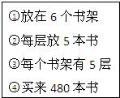

# Mathematics (Grade 3)

**ID**: dce68bca
**难度**: medium_hard
**题型**: fill_in_the_blank

## 题目
选择方框中合适的信息，成为一道连除应用题，并列式计算．问题：平均每层书架放多少本书？
选择$\underline{\hspace{5em}}$号、$\underline{\hspace{5em}}$号和$\underline{\hspace{5em}}$号信息．
列式计算：$\underline{\hspace{5em}}$．

## 解答

**答案**: ④, ①, ③, 480÷6÷5

1. Step1:明确问题是求平均每层书架放多少本书，需要知道书的总数、书架个数以及每个书架的层数。
2. Step2:从所给信息中，④“买来480本书”能提供书的总数，①“放在6个书架”能提供书架个数，③“每个书架有5层”能提供每个书架的层数，所以选择④号、①号和③号信息。
3. Step3:根据连除的思路，先用书的总数除以书架个数，得到每个书架放的本数，再用每个书架放的本数除以每个书架的层数，列式为480÷6÷5。

## 知识点

**知识点**:
  - 平均数的含义及求平均数的方法．

---
