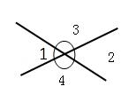

# Mathematics (Grade 3)

**ID**: df1edf83
**难度**: medium_hard
**题型**: fill_in_the_blank

## 题目
如图，已知∠1=70°，∠2= $\underline{\hspace{5em}}$ ，∠3= $\underline{\hspace{5em}}$ ，∠4= $\underline{\hspace{5em}}$ 。

## 解答

**答案**: 70°, 110°, 110°

1. Step1:观察图形，确定∠1和∠3、∠1和∠4组成平角，平角为180°
2. Step2:因为∠1和∠3组成平角，∠1 = 70°，所以∠3 = 180° - ∠1 = 180° - 70° = 110°
3. Step3:因为∠1和∠4组成平角，∠1 = 70°，所以∠4 = 180° - ∠1 = 180° - 70° = 110°
4. Step4:观察图形，确定∠3与∠2组成平角
5. Step5:因为∠3与∠2组成平角，∠3 = 110°，所以∠2 = 180° - ∠3 = 180° - 110° = 70°

## 知识点

**知识点**:
  - 角的认识

---
