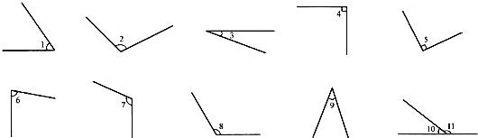

# Mathematics (Grade 3)

**ID**: e2b84b1b
**难度**: medium_hard
**题型**: fill_in_the_blank

## 题目
填一填，知识巩固（填角的符号）

锐角有$\underline{\hspace{5em}}$，直角有$\underline{\hspace{5em}}$，钝角有$\underline{\hspace{5em}}$．

## 解答

**答案**: 1、3、6、9、10, 4、5, 2、7、8、11

1. Step1:明确锐角的定义为大于0度小于90度的角，根据此定义观察图形，找出符合的角为1、3、6、9、10
2. Step2:明确直角的定义为等于90度的角，根据此定义观察图形，找出符合的角为4、5
3. Step3:明确钝角的定义为大于90度小于180度的角，根据此定义观察图形，找出符合的角为2、7、8、11

## 知识点

**知识点**:
  - 角的概念及其分类．

---
