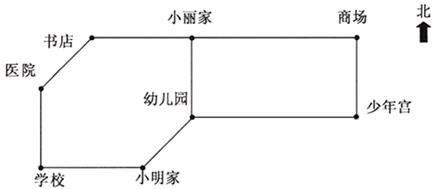

# Mathematics (Grade 3)

**ID**: e597f4d8
**难度**: medium_hard
**题型**: fill_in_the_blank

## 题目
下面是小明和小丽家到各个公共汽车站的路线图． 

（1）小明从家出发去小丽家，先向________走到幼儿园，再向________走到小丽家．   
（2）小明要去商场，从家出发走________站到商场．   
（3）小丽每天上学，先向________走到书店，再向________走到医院，最后向________走到学校．   
（4）小丽上学，还可以________走．

## 解答

**答案**: 东北, 北, 3, 西, 西南, 南, 先向南，走到幼儿园，再向西南，到小明家，最后向西，到学校

1. Step1:观察路线图，小明从家出发去小丽家，根据上北下南左西右东，先向东北方向走到幼儿园
2. Step2:从幼儿园再向北走到小丽家
3. Step3:小明要去商场，从家出发经过幼儿园、小丽家，共走3站到商场
4. Step4:小丽每天上学，先向西走到书店
5. Step5:从书店再向西南走到医院
6. Step6:从医院最后向南走到学校
7. Step7:小丽上学还可以先向南走到幼儿园，再向西南到小明家，最后向西到学校

## 知识点

**知识点**:
  - 小学数学;图形与几何;位置与方向;路线图

---
