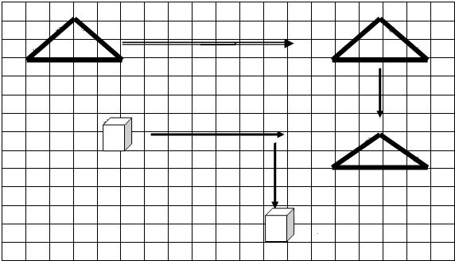

# Mathematics (Grade 3)

**ID**: e62f9c5c
**难度**: medium_hard
**题型**: fill_in_the_blank

## 题目
看图填一填

(1)三角形先向______平移了______格，再向______平移______格．
(2)正方体先向______平移了______格再向______平移______格．

## 解答

**答案**: 右, 13, 下, 6, 右, 6, 下, 5

1. Step1:观察图中三角形的箭头指向和对应点位置，根据解析2可知，通过箭头指向与对应点距离确定平移方向和距离，得出三角形先向右平移
2. Step2:数三角形向右平移的格数，得到平移了13格
3. Step3:继续观察三角形后续的箭头指向和对应点位置，得出三角形再向下平移
4. Step4:数三角形向下平移的格数，得到平移了6格
5. Step5:观察图中正方体的箭头指向和对应点位置，根据解析2确定平移方向和距离，得出正方体先向右平移
6. Step6:数正方体向右平移的格数，得到平移了6格
7. Step7:继续观察正方体后续的箭头指向和对应点位置，得出正方体再向下平移
8. Step8:数正方体向下平移的格数，得到平移了5格

## 知识点

**知识点**:
  - 平移．

---
