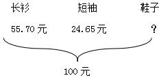

# Mathematics (Grade 3)

**ID**: eb0bb34a
**难度**: medium_hard
**题型**: fill_in_the_blank

## 题目
看图列式计算．

## 解答

**答案**: 19.65

1. Step1:明确已知条件，买一件长衫、一件短袖和一双鞋子总共花费100元，其中长衫价格为55.70元，短袖价格为24.65元
2. Step2:方法一，先计算100减去长衫价格55.70元，即100 - 55.70 = 44.30元
3. Step3:再用上述结果减去短袖价格24.65元，44.30 - 24.65 = 19.65元
4. Step4:方法二，先计算长衫和短袖的总价格，即55.70 + 24.65 = 80.35元
5. Step5:用100元减去长衫和短袖的总价格，100 - 80.35 = 19.65元
6. Step6:得出鞋子的价钱是19.65元

## 知识点

**知识点**:
  - 图文应用题

---
