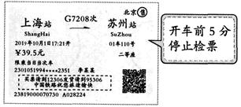

# Mathematics (Grade 3)

**ID**: ec3c98ee
**难度**: medium_hard
**题型**: fill_in_the_blank

## 题目

（1）火车在下午（____）时（____）分开车，下午（____）时（____）分停止检票。
（2）这张火车票在（_______）年（_______）月（______）日使用才有效。
（3）小明一家从家到火车站检票口要55分，他们最晚要在（_______）时（_______）分从家里出发才不会误火车。

## 解答

**答案**: 5, 21, 5, 16, 2019, 10, 1, 16, 21

1. Step1:观察火车票可知火车开车时间为17:21，17 - 12 = 5，所以火车在下午5时21分开车
2. Step2:已知开车前5分钟停止检票，17时21分 - 5分钟 = 17时16分，17 - 12 = 5，所以下午5时16分停止检票
3. Step3:从火车票上能看到乘车日期为2019年10月1日，所以这张火车票在2019年10月1日使用才有效
4. Step4:停止检票时间是17时16分，小明一家从家到火车站检票口要55分，17时16分 - 55分 = 16时21分，所以他们最晚要在16时21分从家里出发才不会误火车

## 知识点

**知识点**:
  - 小学数学;数与代数;常见的量;时间单位及换算;24时计时法与普通计时法的互化;日期和时间的推算

---
