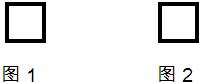

# Mathematics (Grade 3)

**ID**: ee9a6add
**难度**: medium_hard
**题型**: fill_in_the_blank

## 题目
求出图形面积和周长
如图1：边长：16米     
如图2：边长：300厘米．

## 解答

**答案**: 64米, 256平方米, 1200厘米, 90000平方厘米

1. Step1:根据正方形周长公式，图1边长为16米，计算其周长为16×4 = 64米
2. Step2:根据正方形面积公式，图1边长为16米，计算其面积为16×16 = 256平方米
3. Step3:根据正方形周长公式，图2边长为300厘米，计算其周长为300×4 = 1200厘米
4. Step4:根据正方形面积公式，图2边长为300厘米，计算其面积为300×300 = 90000平方厘米

## 知识点

**知识点**:
  - 长方形、正方形的面积；正方形的周长．

---
