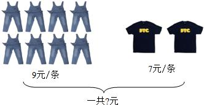

# Mathematics (Grade 3)

**ID**: f25c58e8
**难度**: medium_hard
**题型**: fill_in_the_blank

## 题目
看图列算式

综合算式： $\underline{\hspace{5em}}$ ．

## 解答

**答案**: 9×8+7×2

1. Step1:分析图中背带裤的数量和单价，得出背带裤有8条，每条9元，根据乘法意义，计算8条背带裤的总价为9×8元
2. Step2:分析图中上衣的数量和单价，得出上衣有2件，每件7元，根据乘法意义，计算2件上衣的总价为7×2元
3. Step3:根据加法意义，将8条背带裤的总价与2件上衣的总价相加，得到一共需要的钱数，列出综合算式9×8+7×2

## 知识点

**知识点**:
  - 图文应用题

---
