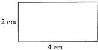

# Mathematics (Grade 3)

**ID**: f417b6e0
**难度**: medium_hard
**题型**: fill_in_the_blank

## 题目
如果用边长是1厘米的小正方形摆可以摆______行，每行摆______个小正方形，一共摆______个小正方形，如果用面积公式计算，列式为______．

## 解答

**答案**: 2, 4, 8, 4*2

1. Step1:根据长方形的宽为2厘米，小正方形边长为1厘米，计算摆的行数，2÷1=2(行)
2. Step2:根据长方形的长为4厘米，小正方形边长为1厘米，计算每行摆的个数，4÷1=4(个)
3. Step3:由行数和每行个数计算一共摆的个数，2×4=8(个)
4. Step4:根据长方形面积公式S=ab，其中a=4厘米，b=2厘米，得出用面积公式计算的列式为4×2

## 知识点

**知识点**:
  - 长方形、正方形的面积．

---
