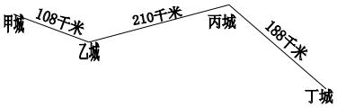

# Mathematics (Grade 3)

**ID**: f925927e
**难度**: medium_hard
**题型**: fill_in_the_blank

## 题目
一辆汽车从甲城出发开往丁城，路线图如图；

（1）填一填．
$\begin{array}{|c|c|}
\hline
 & 路程/千米 \\ \hline
甲城--乙城 &  \\ \hline
乙城--丙城 &  \\ \hline
甲城--丁城 &  \\ \hline
\end{array}$（2）丙城到乙城和丙城到丁城哪段路长？长多少米？

## 解答

**答案**: 108, 210, 506

1. Step1:观察路线图，确定甲城到乙城的路程为108千米
2. Step2:观察路线图，确定乙城到丙城的路程为210千米
3. Step3:计算甲城到丁城的路程，将甲城到乙城、乙城到丙城、丙城到丁城的路程相加，即108+210+188=506千米

## 知识点

**知识点**:
  - 整数的加法和减法

---
