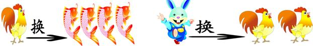

# Mathematics (Grade 3)

**ID**: f9e9f8f5
**难度**: medium_hard
**题型**: fill_in_the_blank

## 题目

①一只鸡可以换$\underline{\hspace{5em}}$条鱼．
②一只兔子可以换$\underline{\hspace{5em}}$只鸡，也可以换$\underline{\hspace{5em}}$条鱼．

## 解答

**答案**: 4, 2, 8

1. Step1:观察图片可知，一只鸡可以换4条鱼，所以第一个空答案为4
2. Step2:观察图片可知，一只兔子可以换2只鸡，所以第二个空答案为2
3. Step3:因为一只鸡可换4条鱼，一只兔子可换2只鸡，所以一只兔子可换鱼的数量为2×4 = 8条，第三个空答案为8

## 知识点

**知识点**:
  - 简单的等量代换问题．

---
