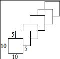

# Mathematics (Grade 3)

**ID**: fd7a869e
**难度**: medium_hard
**题型**: fill_in_the_blank

## 题目

(2008•江都市)如图，将6张边长为10厘米的正方形纸互相重叠，这个图形的周长是______厘米；照这样重叠100张纸，它的周长是______厘米．

## 解答

**答案**: 180, 3000

1. Step1:分析一张正方形纸重叠情况，得出每一个正方形减少的长度为5×2=10厘米，相当于每个正方形剩下3条边
2. Step2:计算6张纸重叠时图形的周长，根据每个正方形剩下3条边，每条边10厘米，可得周长为10×3×6=180厘米
3. Step3:计算100张纸重叠时图形的周长，同样每个正方形剩下3条边，每条边10厘米，所以周长为10×3×100=3000厘米

## 知识点

**知识点**:
  - 重叠问题．

---
