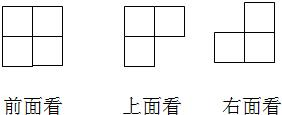

# Mathematics (Grade 3)

**ID**: 0360b88b
**难度**: medium_hard
**题型**: multiple_choice

## 题目
一堆同样大小的正方体拼搭图形，从不同方向看到的图形分别如图：那么至少有（  ）块同样的正方体．
A．5
B．6
C．7
D．8

## 解答

**答案**: A

1. Step1:根据从前面看的图形，可知有2列2层共4个小正方体
2. Step2:依据从上面看的图形，明确有2行，前面一行有1列靠左边，后面一行是2列
3. Step3:由从右面看的图形，得知有2行，前面一行是1个正方体，右边一列是2个正方体
4. Step4:综合上面的信息，确定前面一行只有1个正方体靠左边，后面一行是2列2层，即下层有2个小正方体，上层也有2个小正方体
5. Step5:计算小正方体总数为1+2+2=5个，所以至少有5块同样的正方体，答案选A

## 知识点

**知识点**:
  - 从不同方向观察物体和几何体．

---
