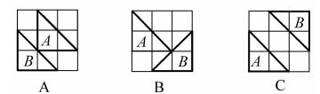

# Mathematics (Grade 3)

**ID**: 0b298b44
**难度**: medium_hard
**题型**: multiple_choice

## 题目
将图形A向左平移1格，再向下平移1格得到的图形B是（）。

## 解答

**答案**: A

1. Step1:明确图形平移的三要素为原位置、平移方向、平移距离，本题中图形A原位置已知，平移方向为向左再向下，平移距离为1格
2. Step2:根据解题方法提示，找出图形A的三个顶点
3. Step3:把图形A的三个顶点分别按照向左平移1格，再向下平移1格的要求进行移动
4. Step4:根据移动后的顶点位置，找出对应的图形，确定答案为A

## 知识点

**知识点**:
  - 平移

---
