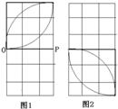

# Mathematics (Grade 3)

**ID**: 0d8c77d7
**难度**: medium_hard
**题型**: multiple_choice

## 题目
由图形1不能变为图形2的方法是（  ）
A．图形1绕O点逆时针方向旋转90°得到图形2
B．图形1绕O点顺时针方向旋转90°得到图形2
C．图形1以线段OP为对称轴画图形1的轴对称得到图形2

## 解答

**答案**: A

1. Step1:分析选项A，判断图形1绕O点逆时针方向旋转90°能否得到图形2，根据观察和图形旋转知识可知不能得到
2. Step2:分析选项B，判断图形1绕O点顺时针方向旋转90°能否得到图形2，由观察和图形旋转知识可得能得到
3. Step3:分析选项C，判断图形1以线段OP为对称轴画图形1的轴对称能否得到图形2，依据轴对称图形性质可知能得到
4. Step4:综合以上分析，得出由图形1不能变为图形2的方法是选项A

## 知识点

**知识点**:
  - 将简单图形平移或旋转一定的度数．

---
