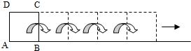

# Mathematics (Grade 3)

**ID**: 0faf97a1
**难度**: medium_hard
**题型**: multiple_choice

## 题目
如图所示，正方形ABCD的边长为1cm，现将正方形ABCD沿水平方向翻滚15次，那么图中点A翻滚后所在的位置与A点开始位置之间的距离为（  ）cm．
A．15
B．16
C．30

## 解答

**答案**: B

1. Step1:明确每滚动4次为一个循环周期，且一个循环周期中A点移动的距离是4个边长的长度之和，正方形边长为1cm，即一个循环周期A点移动4×1 = 4cm
2. Step2:计算15次翻滚包含的循环周期数和剩余翻滚次数，15÷4 = 3…3，即有3个完整的循环周期，还剩余3次翻滚
3. Step3:计算3个循环周期A点移动的距离，3×4 = 12cm
4. Step4:计算剩余3次翻滚A点移动的距离，每次翻滚移动1cm，3次移动3×1 = 3cm
5. Step5:计算前15次翻滚A点总共移动的距离，12 + 3 = 15cm
6. Step6:因为翻完这3次之后的A点到了原来B点的位置，所以最终A点翻滚后所在的位置与开始位置之间的距离要在15cm的基础上再加1cm，即15 + 1 = 16cm

## 知识点

**知识点**:
  - 正方形的周长．

---
