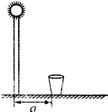

# Mathematics (Grade 3)

**ID**: 15f67fd0
**难度**: medium_hard
**题型**: multiple_choice

## 题目
若路灯的杆子距离某物体$\text{a}$米（如图），则下列说法中，正确的是（ ）

$\begin{description}
\item A．若\text{a}越小，则物体的影子越长\item B．若\text{a}越小，则物体的影子越短\item C．若\text{a}越大，则物体影子的长不会变\item D．若\text{a}越大，则物体的影子越短
\end{description}$

## 解答

**答案**: B

1. Step1:明确路灯杆子与物体距离和影子长度的关系，在灯光下，离点光源越近，影子越短，离点光源越远，影子越长。
2. Step2:分析选项A，a越小说明物体离路灯杆子越近，根据上述关系，物体影子应越短，所以A错误。
3. Step3:分析选项B，a越小即物体离路灯杆子越近，物体的影子越短，该选项正确。
4. Step4:分析选项C，a越大意味着物体离路灯杆子越远，物体影子应该越长，而不是影子长不变，所以C错误。
5. Step5:分析选项D，a越大表示物体离路灯杆子越远，物体影子应越长，而不是越短，所以D错误。

## 知识点

**知识点**:
  - 小学数学;图形与几何;位置与方向;位置

---
