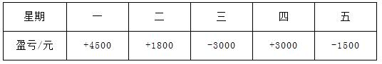

# Mathematics (Grade 3)

**ID**: 165d41ec
**难度**: medium_hard
**题型**: multiple_choice

## 题目
某商店一周内的盈亏情况如下表：

这个商店这周内总情况是（ ）
$\begin{description}
\item A．盈利\item B．亏损\item C．不盈不亏
\end{description}$

## 解答

**答案**: A

1. Step1:将一周内每天的盈亏金额相加，即列出算式（+4500）+（+1800）+（-3000）+（+3000）+（-1500）
2. Step2:先计算 -3000 与 +3000 的和为 0，算式化简为（+4500）+（+1800）+（-1500）
3. Step3:计算（+4500）+（+1800）= 6300，得到 6300 +（-1500）
4. Step4:计算 6300 +（-1500）= +4800（元）
5. Step5:因为结果为 +4800 元大于 0，所以这周是盈利的，答案选 A

## 知识点

**知识点**:
  - 

---
