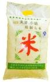

# Mathematics (Grade 3)

**ID**: 1667d33a
**难度**: medium_hard
**题型**: multiple_choice

## 题目
一袋大米重10千克，1吨大米可以装这样的多少袋．（  ）

$\begin{description}
\item A．100\item B．1000\item C．10\item D．10000
\end{description}$

## 解答

**答案**: A

1. Step1:将1吨的单位换算为千克，因为1吨 = 1000千克
2. Step2:明确问题是求1000千克里面有几个10千克
3. Step3:用除法计算1000÷10 = 100
4. Step4:得出1吨大米可以装100袋，答案选A

## 知识点

**知识点**:
  - 整数的除法及应用；质量的单位换算．

---
