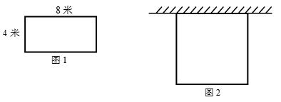

# Mathematics (Grade 3)

**ID**: 16ebac2c
**难度**: medium_hard
**题型**: multiple_choice

## 题目
王奶奶家的院子里原来有一个长8米、宽4米的全部用栅栏围成的长方形鸡舍（如图1所示）。她在院子墙边重新建一个一面靠墙的正方形鸡舍（如图2所示），如果只用原来鸡舍的旧栅栏围，那么王奶奶最大可以围成一个边长是（     ）米的正方形鸡舍。

$\begin{description}
\item A．3\item B．4\item C．6\item D．8
\end{description}$

## 解答

**答案**: D

1. Step1:先计算原来长方形鸡舍的周长，根据长方形周长公式C=(a + b)×2（其中a为长，b为宽），可得(8 + 4)×2 = 24米，即旧栅栏的长度为24米。
2. Step2:因为新鸡舍一面靠墙，所以24米栅栏只围正方形鸡舍的三条边。
3. Step3:根据正方形三条边长度相等，用栅栏总长度除以3可得正方形鸡舍的边长，即24÷3 = 8米。

## 知识点

**知识点**:
  - 小学数学;图形与几何;平面图形;长方形和正方形;长方形的周长;正方形的周长

---
