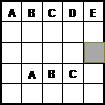

# Mathematics (Grade 3)

**ID**: 1874de90
**难度**: medium_hard
**题型**: multiple_choice

## 题目
如图，在5×5的方格中分别填入A、B、C、D、E五个字母，使得每行、没列、每条对角线上的五个方格中都恰好有这五个字母各1个，则阴影部分的方格中填入的字母是(    )．

## 解答

**答案**: A

1. Step1:观察方格，明确目标是使每行、每列、每条对角线上都恰好有A、B、C、D、E各1个
2. Step2:确定中心位置①，由于它所在行已有B、C、A，所在列已有E，根据条件可知①只能是D
3. Step3:确定位置②，因为它所在行已有D、C、A，所在列已有E，所以②只能是B
4. Step4:确定位置③，鉴于它所在行已有B、C、D，所在列已有A，所以③只能是E
5. Step5:确定位置④，由于它所在行已有A、B、D，所在列已有E，所以④只能是C
6. Step6:确定位置⑤，因为它所在行已有A、C、D，所在列已有E，所以⑤只能是B
7. Step7:分析阴影部分的字母，它所在行已有C、D、E，所在列已有B，所以阴影部分只能是A

## 知识点

**知识点**:
  - 幻方．

---
