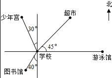

# Mathematics (Grade 3)

**ID**: 1da58886
**难度**: medium_hard
**题型**: multiple_choice

## 题目
如图，下列描述错误的是（  ）

A．少年宫在学校的西偏北60°
B．超市在学校的东偏北45°
C．游泳馆在学校的东面
D．图书馆在学校的西偏南40°
E．游泳馆在学校的东面

## 解答

**答案**: D

1. Step1:根据上北下南，左西右东的方位辨别方法，以学校为观测点，判断少年宫的位置，得出少年宫在学校的西偏北60°，A选项正确
2. Step2:以学校为观测点，判断超市的位置，得出超市在学校的东偏北45°，B选项正确
3. Step3:以学校为观测点，判断游泳馆的位置，得出游泳馆在学校的东面，C、E选项正确
4. Step4:以学校为观测点，判断图书馆的位置，得出图书馆在学校的西偏南50°，而不是西偏南40°，D选项错误

## 知识点

**知识点**:
  - 方向．

---
