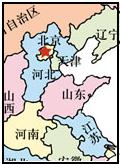

# Mathematics (Grade 3)

**ID**: 21896234
**难度**: medium_hard
**题型**: multiple_choice

## 题目
如图中，北京市在山东省的（  ）

A．西偏南方向
B．东偏南方向
C．西偏北方向

## 解答

**答案**: C

1. Step1:明确要判断北京市在山东省的方向
2. Step2:依据上北下南，左西右东的方位规则
3. Step3:观察图中北京市相对于山东省的位置
4. Step4:得出北京市在山东省的西偏北方向，所以答案选C

## 知识点

**知识点**:
  - 方向．

---
