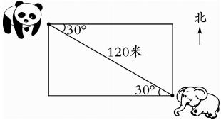

# Mathematics (Grade 3)

**ID**: 25087d28
**难度**: medium_hard
**题型**: multiple_choice

## 题目
小象在熊猫的（）方向120米处。

A.西偏南60°
B.西偏北60°
C.东偏南30°

## 解答

**答案**: C

1. Step1:明确地图上的方向规则为上北下南，左西右东
2. Step2:以熊猫为观测点观察小象的位置
3. Step3:结合图中所给30°角度，判断出小象在熊猫的东偏南30°方向
4. Step4:根据题目选项，得出答案为C

## 知识点

**知识点**:
  - 根据方向和距离确定位置

---
