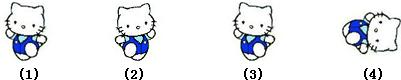

# Mathematics (Grade 3)

**ID**: 2985e4df
**难度**: medium_hard
**题型**: multiple_choice

## 题目
如图图片中，哪些是由图片（1）分别经过平移和旋转得到的（  ）

$\begin{description}
\item A．（3）和（4）\item B．（2）和（3）\item C．（2）和（4）\item D．（4）和（3）
\end{description}$

## 解答

**答案**: A

1. Step1:明确平移的性质，即经过平移，对应线段平行（或共线）且相等，对应角相等，对应点所连接的线段平行且相等，平移变换不改变图形的形状、大小和方向（平移前后的两个图形是全等形）
2. Step2:明确旋转的性质，即对应点到旋转中心的距离相等，对应点与旋转中心所连线段的夹角等于旋转角，旋转前、后的图形全等
3. Step3:观察发现图（1）沿一直线平移可得到（3）
4. Step4:观察发现图（1）顺时针旋转可得到（4）
5. Step5:根据上述观察结果，可知由图片（1）分别经过平移和旋转得到的是（3）和（4），所以答案选A

## 知识点

**知识点**:
  - 平移；旋转．

---
