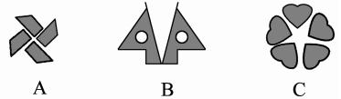

# Mathematics (Grade 3)

**ID**: 383b6fe2
**难度**: medium_hard
**题型**: multiple_choice

## 题目
下列图形不能通过旋转构成的是（）。

## 解答

**答案**: B

1. Step1:明确旋转的三要素为定点（旋转中心）、旋转方向、旋转角度
2. Step2:分析选项A，发现将一个基本图形连续旋转90°可构成该图形
3. Step3:分析选项B，根据旋转知识判断其不能通过旋转构成
4. Step4:分析选项C，可知其可以通过旋转构成
5. Step5:得出不能通过旋转构成的图形是B

## 知识点

**知识点**:
  - 旋转

---
