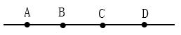

# Mathematics (Grade 3)

**ID**: 41035b26
**难度**: medium_hard
**题型**: multiple_choice

## 题目
下图中共有（   ）线段。 

A．4条
B．5条
C．6条

## 解答

**答案**: C

1. Step1:从A点开始，以A为端点的线段有AB、AC、AD，共3条
2. Step2:从B点开始，以B为端点的线段有BC、BD，共2条
3. Step3:从C点开始，以C为端点的线段有CD，共1条
4. Step4:将上述线段数量相加，3 + 2 + 1 = 6条
5. Step5:因为共有6条线段，所以答案选C

## 知识点

**知识点**:
  - 

---
