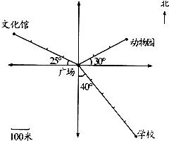

# Mathematics (Grade 3)

**ID**: 42a38eee
**难度**: medium_hard
**题型**: multiple_choice

## 题目
下面三句话中，叙述不正确的是(  )
A．动物园在广场东偏北30°的方向
B．文化馆在广场西偏北25°的方向
C．学校在广场南偏西40°的方向

## 解答

**答案**: C

1. Step1:根据“上北下南，左西右东”的方向标，判断动物园与广场的位置关系，得出动物园在广场东偏北30°的方向，A选项叙述正确
2. Step2:根据方向标，判断文化馆与广场的位置关系，得出文化馆在广场西偏北25°的方向，B选项叙述正确
3. Step3:根据方向标，判断学校与广场的位置关系，得出学校在广场南偏东40°的方向，并非南偏西40°，C选项叙述不正确

## 知识点

**知识点**:
  - 根据方向和距离确定物体的位置．

---
